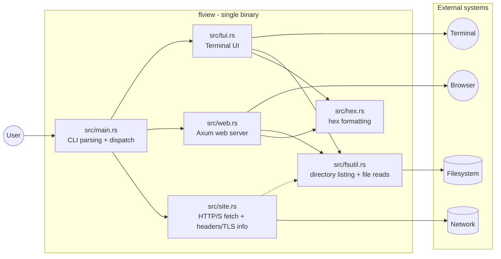
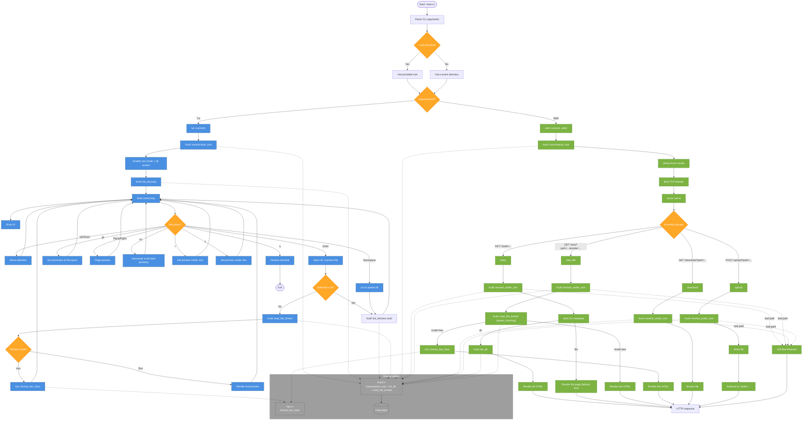

# Diagrams

## Architecture

`flview` has three user-facing modes (TUI, Web, Site) that share filesystem + preview helpers, which allows to use inside a K8S pod to check https and view file.

Notes:
- `src/main.rs` is the single entrypoint and selects the mode based on the subcommand.
- `src/fsutil.rs` and `src/hex.rs` are shared helpers used by both TUI and Web; `site` is network-only.
- `site --resolveto <IPV4>` overrides the TCP connect addresss but keeps the URL host for HTTP `Host` and (for HTTPS) SNI/cert validation.

## Program Flow

